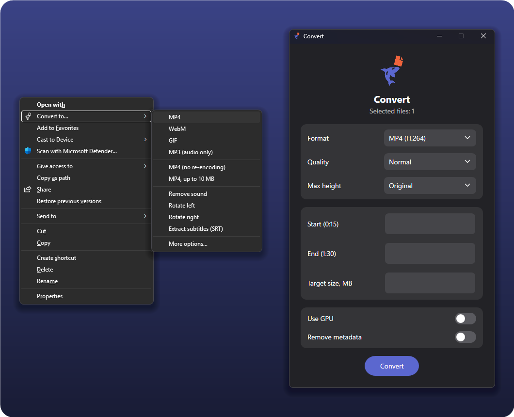

# explorer-convert

Adds a **Convert to…** submenu to the Windows Explorer context menu for video, audio, images, PDF, office documents and e-books. Results are saved next to the originals, which are never modified or overwritten.

No uploads, no ads, no file limits: files are converted on your own computer.

A Windows version of [dolphin-convert](https://github.com/ekmryze21/dolphin-convert).



## Install

Install the main tools:

```powershell
winget install -e --id Gyan.FFmpeg
winget install -e --id ImageMagick.ImageMagick
winget install -e --id oschwartz10612.Poppler
```

[Download](../../archive/HEAD.zip) and unpack the repository, open PowerShell in its folder and run:

```powershell
powershell -ExecutionPolicy Bypass -File install.ps1
```

This changes the execution policy for that one command only. The program is copied to `%LOCALAPPDATA%\explorer-convert` and the menu is registered for the current user. explorer-convert needs no administrator rights, but the tools' own installers may ask for them.

Missing tools are listed with the command or page to get them, and their menu items stay hidden. After installing a tool, changing the system language or switching between light and dark mode, run the installer again.

### Windows 11

The submenu is in the classic menu: **Show more options**, or **Shift + right click**. The installer offers to always open the classic menu instead of the new one. You can also do it later:

```powershell
powershell -ExecutionPolicy Bypass -File install.ps1 -ClassicMenu
```

And to return to the Windows 11 menu:

```powershell
powershell -ExecutionPolicy Bypass -File install.ps1 -ModernMenu
```

This applies to all files and folders of the current user, not only to explorer-convert, and takes effect after Explorer restarts. Microsoft does not document this setting, so a Windows update may stop it from working.

On Windows 10 the submenu is in the normal context menu.

## Formats

| Files | Convert to | Also |
| --- | --- | --- |
| Video | MP4 (H.264, H.265, AV1), WebM (VP9), GIF, MP3, MP4 and MKV without re-encoding | rotate, remove sound, extract the first subtitle track |
| Audio | MP3, M4A, Opus, OGG, FLAC, WAV | |
| Images | JPG, PNG, WebP, AVIF, JXL, TIFF, GIF, BMP, ICO, PDF | one PDF from all images; HEIC and camera RAW as a source |
| PDF | PNG and JPG (a folder if there are several pages), TXT | merge, split, compress, recognize text |
| Documents | PDF, DOCX, ODT | |
| Spreadsheets | PDF, XLSX, ODS, CSV (first sheet) | |
| Presentations | PDF, PPTX, ODP | |
| E-books | EPUB, MOBI, AZW3, PDF, TXT | |

Common conversions are one click away. **More options…** for video, audio and images adds, where it applies:

- quality and maximum height
- trimming
- a target file size
- metadata removal
- GPU encoding

Format, quality, height, metadata and GPU choices are remembered.

Available in English, Ukrainian, German, Spanish, French, Polish, Dutch and Catalan, following the system language.

## Requirements

Windows 10 or 11.

<details>
<summary>Full list</summary>

- Windows PowerShell 5.1 (built in) and Windows Script Host enabled (the default)
- [FFmpeg](https://ffmpeg.org/download.html) with libx264, libx265, libsvtav1, libaom, libvpx-vp9, libopus, libvorbis and libmp3lame for video and audio, and for AVIF images
- [ImageMagick 7](https://imagemagick.org/script/download.php#windows) for images
- [Poppler](https://github.com/oschwartz10612/poppler-windows/releases) for PDF

Optional:

- [LibreOffice](https://www.libreoffice.org/download/) for office documents: `winget install -e --id TheDocumentFoundation.LibreOffice`
- [Calibre](https://calibre-ebook.com/download_windows) for e-books: `winget install -e --id calibre.calibre`
- [Ghostscript](https://ghostscript.com/releases/gsdnld.html) for PDF compression
- [Tesseract](https://github.com/tesseract-ocr/tesseract) and [OCRmyPDF](https://ocrmypdf.readthedocs.io/en/latest/installation.html) for text recognition. OCRmyPDF needs Python:

```powershell
winget install -e --id tesseract-ocr.tesseract
winget install -e --id Python.Python.3.13
py -m pip install ocrmypdf
```

Text is recognized in English, and also in Ukrainian and the system language if Tesseract has data for them. Put [language data](https://github.com/tesseract-ocr/tessdata_fast) such as `ukr.traineddata` into the `tessdata` folder of Tesseract.

</details>

## Notes

- Files selected together are converted together, pages of a joint PDF go in natural name order (2 before 10). The same action started on two selections within a few seconds is treated as one.
- Explorer hands over at most 100 files. Larger selections are read from the Explorer window, which does not work for files on the desktop itself: select up to 100 there.
- Trimming without re-encoding cuts at the nearest keyframe.
- GPU encoding (NVENC, QSV or AMF) applies to H.264 and H.265 and falls back to the CPU. A target size always uses the CPU.
- Animated images are converted as their first frame.
- Converting from AVIF drops transparency; converting to AVIF keeps it.

## Uninstall

```powershell
powershell -ExecutionPolicy Bypass -File install.ps1 -Uninstall
```

If the classic menu was turned on by explorer-convert, the Windows 11 menu comes back. The tools stay installed.

## Development

`powershell -ExecutionPolicy Bypass -File test.ps1` runs real conversions in a temporary folder with stubbed dialogs. It also runs in PowerShell 7 on Linux, without the launcher part. Set `EXPLORER_CONVERT_SAMPLES` to a folder with `basic-en.pdf`, `basic-en.odt`, `basic-de.odt` and `bbb_short.mp4` to test on those too. `test-install.ps1` installs and uninstalls with stubbed tools; it refuses to run over an existing installation. Add languages in `lang.json`.

## Why

I got tired of going through thirty websites every time, looking for one that converts a file for free and without ruining the quality.

I made the [Linux version](https://github.com/ekmryze21/dolphin-convert) first, and it was surprisingly easy. Unlike this one, which I made for a friend.

Everything is local, fast and in one place. I'll be glad if at least a couple of people find it useful.

## Thanks

Dutch translation: morxd. Spanish and Catalan: treshhyk.

## License

[MIT](LICENSE)
